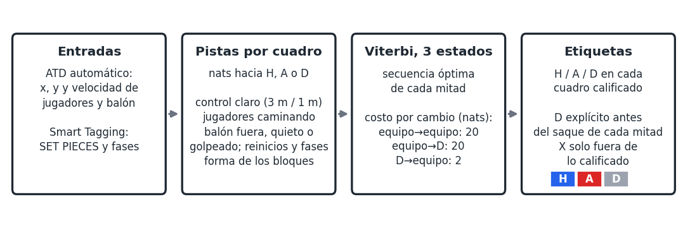
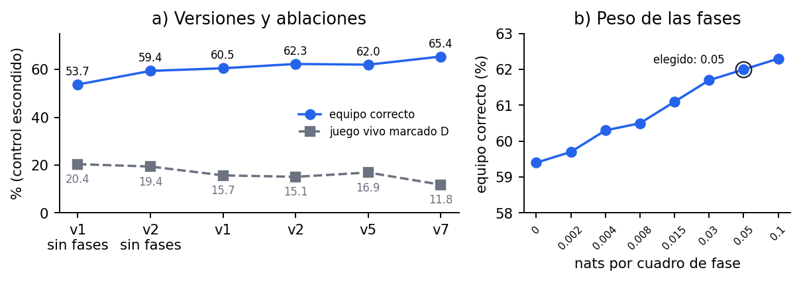

# Tiki-Data: posesión cuadro a cuadro con evidencia y Viterbi de tres estados

More Than a Hack 2027, Initial Challenge · Equipo Tiki-Data: Andrés (modelado), Ruben Robles
(video y datos), José Roberto Díaz Rojas (fútbol, documento y entrega).

Describe la **v7**, la versión congelada el 12 nov 2026, con huella SHA-256
`aff8290262161f5fb4bb96897e320eacebab03e0ec43420173af2052ef235ab9`.
Código: https://github.com/ANDIRIOUS/td27-pipeline

## 1. Resumen

Etiquetamos los 199,319 cuadros del Barça–Athletic sin ver el video y sin una sola etiqueta humana.
El modelo lee el tracking automático (ATD) y el Smart Tagging, convierte cada cuadro en "pistas" a
favor del Barça (`H`), del Athletic (`A`) o del balón muerto (`D`), y luego elige la secuencia de
toda la mitad que mejor explica esas pistas cobrando un costo por cada cambio (figura 1). Todo es
numpy y pandas, corre en un contenedor fijado y regenera el mismo archivo byte a byte.



*Figura 1. Del tracking a las etiquetas: pistas por cuadro en nats y Viterbi de tres estados.*

## 2. Enfoque

### 2.1 Qué premia la métrica, y qué decidimos por eso

La nota principal, `spellF1`, no cuenta cuadros: cuenta **posesiones completas** que se empalman
con las reales (por traslape temporal, o IoU, promediado entre 0.3 y 0.7). Partir una posesión en
dos o inventar un cambio de dueño cuesta mucho más que fallar cuadros sueltos. Lo vemos en los
baselines oficiales: el mismo algoritmo con distinta ventana de suavizado va de 0.0486 a 0.2433 de
`spellF1`, mientras su `macroF1` casi no se mueve.

Al explorar los datos encontramos dos cosas que definen todo el diseño:

1. **Con el balón vivo y visible, el equipo ya se adivina bien** con el jugador más cercano. Lo que
   falla es el balón muerto: el tracker pierde el balón en el 41% de los cuadros calificados, en
   huecos largos (mediana de 10 s), y no solo cuando está muerto. "No veo el balón" no significa
   "está muerto", y cada `D` mal puesto parte una posesión.
2. **Cuando el balón está muerto, los jugadores caminan.** En el 25% de los cuadros calificados la
   mediana de velocidad de los jugadores está por debajo de 1 m/s, y ahí el balón solo se ve el 22%
   del tiempo. Esta señal existe aunque el tracker pierda el balón.

**Por qué este enfoque y no *deep learning*.** Es un solo partido, no podemos entrenar con
etiquetas humanas de él y todo tiene que ser reproducible y explicable (sobre todo por el tiempo).
Un modelo de evidencia con un algoritmo de secuencia no necesita etiquetas y cada constante tiene
una razón física o futbolística.

### 2.2 Pistas por cuadro

Cada pista suma puntos en **nats**, la unidad natural del log-odds: +1 nat a favor de una opción
equivale a multiplicar sus momios por e (Euler). Solo importan las diferencias entre las tres
opciones. Las constantes están en `solution/v1.py` y `solution/v2.py`, fijadas antes de mirar
resultados.

| pista | regla | por qué |
|---|---|---|
| **Control claro** | El jugador más cercano al balón está a menos de 3 m y el rival más cercano al menos 1 m más lejos: +1 nat por cuadro a su equipo. | Un balón en el aire, un rebote o un duelo cerrado no aportan nada, y entonces se mantiene el último poseedor, como pide el reto. |
| **Jugadores caminando** | Mediana de velocidad de los jugadores, suavizada a 2 s. Por debajo de 1.3 m/s suma hacia `D` (3 nats por m/s de diferencia, con tope de ±3). | Es la mejor señal de balón muerto que tenemos y no depende del balón. |
| **Balón fuera** | Balón visto a más de ~0.5 m tras la línea de fondo o ~0.7 m tras la banda: +4 hacia `D`. Si salió y no lo hemos visto rodar dentro, sigue "pendiente": +1.5. | El margen evita que el ruido de posición sobre la línea cuente como salida. |
| **Balón quieto o golpeado** | Quieto (menos de 0.7 m/s) dentro del campo: +1 hacia `D`. Golpeado (más de 8 m/s): 0.5 hacia vivo. | Un balón colocado anticipa un reinicio; un balón pateado fuerte es juego. |
| **Balón faltante** | No suma nada (0 nats). | No ver el balón no dice nada sobre vivo o muerto. Hasta la v5 sumaba 0.3 nats por cuadro hacia `D`: un hueco de 10 s acumulaba ~75 nats, contra 20 para entrar a `D` (2.6). |
| **Reinicios del Smart Tagging** | En cada `SET PIECES`, de 4 s antes del `start` hasta el primer movimiento real cuenta como muerto (+1); después, vivo. | El reinicio cae unos segundos después del `start` del tag, pero no a un desfase fijo (ver 2.4). |
| **Fases del Smart Tagging** | Las fases con equipo empujan 0.05 nats por cuadro hacia el equipo que ataca. En las fases `DEFENDING…`, el `Team` es el que defiende. | Son automáticas y ruidosas, por eso pesan poco (ver 2.6). |
| **Forma de los bloques** | Solo donde no hay control claro: un clasificador estima qué equipo ataca por la forma de los dos bloques (2.3). | Cubre los huecos sin balón, donde antes solo se podía mantener al último equipo. |

### 2.3 El clasificador colectivo y sus pseudo-etiquetas

Cuando nadie controla el balón, la forma de los equipos delata quién ataca: el que tiene el balón
se abre y avanza. Lo aprendemos con una **regresión logística ridge**, entrenada por
Newton-Raphson: determinista y solo con numpy.

- **Entradas:** 18 features de la forma de los bloques, sin usar el balón, suavizadas a 2 s. Por
  equipo: centroide, amplitud en x y en y, velocidad hacia el arco rival, velocidad media, y
  jugadores más retrasado y más adelantado; además, los contrastes entre los dos bloques.
- **Ejemplos:** los ~40 mil cuadros con control claro y jugadores en movimiento. Son
  **pseudo-etiquetas**: las marca la regla de 3 m y 1 m, no una persona. Se aplica solo donde no
  hay control claro, que son justo los cuadros con los que no se entrenó.
- **Calidad:** en validación cruzada por bloques de 5 min acierta el 77% de las pseudo-etiquetas
  (log-loss 0.51 contra 0.67 de la base).
- **Peso:** 1/25 por cuadro, porque con features suavizadas a 2 s hay ~1 observación independiente
  por segundo. El log-odds se recorta a ±2, porque en validación cruzada las probabilidades
  extremas se cumplen ~85%, no 99%.

### 2.4 Viterbi: elegir la secuencia completa

En vez de decidir cuadro por cuadro, usamos **Viterbi**: encuentra la secuencia de `H`/`A`/`D` de
toda la mitad con el mayor puntaje total, sumando las pistas de cada cuadro y restando un costo por
cada cambio de estado. En la práctica funciona como una histéresis (hace falta evidencia sostenida
para cambiar) sin fijar ventanas a mano.

| cambio | costo | qué significa en el campo |
|---|---|---|
| de un equipo al otro | 20 nats | ~0.8 s de control claro del rival. Un toque o un desvío no bastan. Una recuperación corta (ida y vuelta) paga dos veces: el rival necesita más de ~1.6 s. |
| de un equipo a `D` | 20 nats | Varios segundos de señal de muerto. La parada más corta, el saque de banda, dura más de 10 s (sección 5). |
| de `D` a un equipo | 2 nats | Casi gratis: todo reinicio tiene un poseedor claro. |

**Reinicio anclado.** El "vivo" tras un `SET PIECES` empieza en el primer movimiento real dentro de
los 20 s siguientes al `start`: el balón rueda dentro del campo o los jugadores pasan de caminar a
correr. Contra un juez que no supone ningún desfase (2.5), el ancla cae a menos de 1 s del golpe
real en el 82% de los casos con balón visible, contra 29% de un desfase fijo de 3 s.

**Saques iniciales.** Antes del saque de cada mitad escribimos `D` explícito. Si pusiéramos `X`, el
scorer rellenaría hacia atrás con el equipo que saca y la primera posesión empezaría minutos antes.
El `D` llega hasta el golpe que detecta el juez de reinicios (1er tiempo: +3.7 s tras el tag). Si
el juez no lo ve, como en el 2º tiempo, se usa la mediana de los saques de centro que sí detectó
(+3.4 s, con 4 saques), calculada en el código.

**Nunca escribimos `X` en un cuadro calificado.** Para `spellF1`, `X` equivale a repetir la etiqueta
anterior. Escribir esa misma etiqueta da el mismo `spellF1` y no regala `macroF1`, que es el
desempate.

### 2.5 Cómo comparamos versiones sin etiquetas

Las versiones se comparan **sobre el partido completo y sin etiquetas**; la ventana pública de
5 minutos solo verifica el pipeline y se puntuó una sola vez, al final. Para cada pregunta fijamos
en un commit aparte la rejilla de valores, el criterio y la regla de elección **antes de correr
nada**. El historial de commits es privado; está disponible para los organizadores si lo piden.

- **`diagnose.py`:** cuántas posesiones salen y cuánto duran, % de `D`, acuerdo con las fases del
  Smart Tagging (circular, porque el modelo las usa) y reinicios bien ubicados.
- **Prueba de huecos (`huecos.py`):** escondemos el balón donde sí había control claro, con huecos
  del largo de los reales (mediana 8.9 s), y medimos si el modelo acierta el equipo. Son 20
  réplicas con semilla fija. No depende de las fases.
- **Juez de reinicios (`reinicios.py`):** en saques de centro, córners y saques de meta el
  reglamento fija dónde está el balón, así que el primer arranque del balón en ese lugar marca el
  golpe real. Lo detecta en 17 de 28 balones parados; ahí se ve que el "tag + 3 s" solo vale
  para los saques de centro.

| versión | qué cambia | huella SHA-256 |
|---|---|---|
| v1 | pistas por cuadro + Viterbi | `463dcdf8badc4f6babbcd11825264ac861caa38bcb2df5af40176a6b99473418` |
| v2 | + clasificador colectivo + reinicio anclado | `0677dda7f0527b05cbbd2d6afbb96df85a3714018ce14bb4ffe32910d8c997c5` |
| v3 | fases a 0.05 en vez de 0.1 | `059cdc2d144391ec95f43c3420af3d325f4fc0c452f6b2a20750b65cad2afa60` |
| v4 | reinicio con movimiento sostenido (descartada) | no publicada |
| v5 | saques iniciales con el juez, sin constantes a mano | `b7a2f894600e512aef3bdf108e58fab76ca49a17922f37b575a3d4b0fe4d4389` |
| **v7** (congelada) | v5 sin la pista de balón faltante | `aff8290262161f5fb4bb96897e320eacebab03e0ec43420173af2052ef235ab9` |

Las huellas salen iguales en Docker arm64 y amd64 (`solution/README.md`).

### 2.6 Decisiones, con el dato que las respalda

| decisión | qué probamos | qué salió | resultado |
|---|---|---|---|
| **Clasificador colectivo** (v2) | v1 y v2, con y sin fases, en la prueba de huecos | Equipo correcto en huecos: v1 sin fases 53.7%, v2 sin fases 59.4%, v1 60.5%, v2 62.3%. Aporta ~6 puntos sin fases y ~2 con fases. | Entra. |
| **Peso de las fases** (v3) | Ocho pesos de 0 a 0.1; regla: el más bajo a menos de un error estándar del mejor | La sospecha de que pesaban de más no se sostuvo: más peso siempre ayuda un poco (59.4% con 0, 62.3% con 0.1). La regla elige 0.05 (62.0%). | Entra 0.05. Nos quedamos con la mitad porque la prueba puede favorecer a las fases: en los huecos simulados Metrica sí vio el balón. |
| **Reinicio con movimiento sostenido** (v4) | Exigir 2 s de carrera antes de dar el juego por reanudado | Las posesiones cortas entre dos `D` bajan de 20 a 18, pero todos los reinicios llegan tarde: contra el juez, el ancla cae +1.1 s tarde y solo 29% a menos de 1 s, contra 82% del ancla actual. Los jugadores tardan en arrancar a correr. | Descartada con evidencia. Queda en el repo para que el resultado se reproduzca. |
| **Saques iniciales con el juez** (v5) | Cambiar el "tag + 3 s" comprobado a mano por la regla del juez | Cambian 13 cuadros; la primera posesión de cada mitad empieza 0.1 s y 0.4 s más tarde; `diagnose.py` da lo mismo. | Entra: ya no queda ninguna constante sacada de mirar momentos concretos del partido. |
| **Costo de cambio de equipo** (`cambios.py`) | Seis costos de 20 a 5, contando recuperaciones del rival "tragadas" contra posesiones "inventadas" sin control | La suma es 43 con 20 y con 15, 45 con 12.5, 58 con 10, 95 con 7.5 y 167 con 5. Cada recuperación rescatada se paga con una posesión inventada. | Se queda en 20: ya es el equilibrio. |
| **Pista de balón faltante** (`muertos.py`) | Cinco valores de 0.3 a 0 | El juego vivo marcado como muerto en huecos baja de 16.9% a 11.8% y el equipo correcto sube de 62.0% a 65.4%. Los muertos seguros no se mueven (balón fuera 96.6%, jugadores caminando 97.2%). | La regla elige 0: es la v7. |

**Un intento fallido que contamos.** La primera versión del juez buscaba el balón quieto y luego
pateado, y no detectó ninguno de los 33 balones parados: el ATD casi nunca ve el balón colocado.
Cambiamos la detección antes de medir cualquier regla contra el juez.

### 2.7 Resultados

`diagnose.py` sobre el partido completo, sin etiquetas:

| | posesiones | mediana | % `D` | acuerdo fases | sin balón | reinicios bien | cortas `D`-x-`D` |
|---|---|---|---|---|---|---|---|
| baseline smooth50 | 594 | 4.6 s | 32.3% | 64.3% | 48.1% | 55.9% | |
| **v7** | **242** | **10.5 s** | **39.8%** | 81.8%* | 88.3%* | **74.6%** | **17** |

\* Circular: el modelo usa las fases como evidencia. "Cortas" son posesiones de menos de 5 s con
`D` antes y después.

La figura 2 resume la prueba de huecos: progresión de versiones, ablaciones y barrido del peso de
las fases.



*Figura 2. Prueba de huecos simulados (20 réplicas, semilla 2027), sobre el partido completo y sin
etiquetas. a) Equipo correcto y juego vivo marcado `D` por versión. b) Equipo correcto según el peso
de las fases; la regla fijada antes de correr eligió 0.05.*

**Ventana pública (5 min, 17 posesiones).** La puntuamos una sola vez, el 12 nov 2026, con la v7 ya
congelada:

| versión | macroF1 ventana | spellF1 ventana | spellF1 partido completo (oficial) |
|---|---|---|---|
| **v7** | 0.8112 | 0.3771 | no se conoce |
| baseline smooth50 | 0.6207 | 0.3256 | 0.2433 |
| baseline smooth125 | 0.5812 | 0.4242 | 0.2242 |

Con 17 posesiones el ruido de `spellF1` es de ±0.35, así que la ventana solo confirma que el
pipeline funciona; no se usó para elegir versión.

## 3. Assets usados y descartados

| asset | ¿lo usamos? | cómo |
|---|---|---|
| ATD táctico (posición y velocidad por slot y del balón) | **Sí**, es la base | Control claro, velocidad de los jugadores, balón fuera, quieto o golpeado, forma de los bloques. |
| Smart Tagging táctico | **Sí**, con poco peso | Reinicios (`SET PIECES`) y fases con equipo. Es automático, no ground truth: lo usamos como pista débil. |
| Metadatos del ATD (XML) | Sí | Para saber de qué equipo es cada slot (con la función del starter). |
| Homografía táctica | No | El ATD ya viene en coordenadas de campo; el pipeline no la necesita. |
| Video táctico | No en el pipeline | El código nunca abre un video. Solo se mira para entender y depurar, sin convertir lo visto en etiquetas ni en constantes. |
| Broadcast (video, ATD, homografía) | No | Lo sincronizamos con el táctico (`solution/broadcast_sync.py`), pero su balón solo rellena el 8.7% de los cuadros sin balón (5.2% en huecos de más de 10 s), y donde ambos lo ven el 11.4% difiere en más de 5 m. |

**Cómo tratamos el tracking faltante y ruidoso.**

- **Balón faltante (41% de lo calificado):** no cuenta como muerto (2.2); el Viterbi mantiene al
  último poseedor y el clasificador colectivo rellena los huecos con la forma de los bloques.
- **Identidades que se cambian:** un salto de más de 12 m/s entre cuadros en un slot se trata como
  cambio de identidad y no entra en las velocidades del clasificador.
- **Unidades:** el XML dice `kph`, pero los valores solo son plausibles en m/s. Usamos m/s.
- **Smart Tagging ruidoso:** sus fases coinciden con el control claro en el 72% de los cuadros y
  cubren el 68% de lo calificado, por eso pesan poco.

## 4. Datos de entrenamiento

**No usamos ninguna etiqueta humana**, ni de este partido ni de otros.

| datos | fuente | quién etiquetó | cuánto |
|---|---|---|---|
| Pseudo-etiquetas del clasificador colectivo | Este partido: cuadros con control claro y jugadores en movimiento | Nadie: las marca la regla de 3 m y 1 m de `v1.control` | ~40 mil cuadros |

- Ninguna persona decide ninguna pseudo-etiqueta; las reglas del reto lo permiten de forma
  explícita ("Learning without human labels").
- No usamos datos humanos del partido (Opta, StatsBomb, tracking corregido ni ninguno otro). El
  Smart Tagging es automático y lo dan los organizadores.
- La ventana pública no se usó para entrenar, ajustar ni elegir versiones.
- La investigación de fútbol de la sección 5 usa solo promedios publicados de otras temporadas y
  otros partidos, y no alimenta al modelo: sirve para justificar reglas y como control de cordura.

## 5. Reglas de posesión implementadas

Esta sección se apoya en una investigación interna del equipo, de José Roberto Díaz Rojas ("Balón
muerto y posesión en el fútbol de élite" y "Reglas del reto y dónde metimos alertas", 10 nov
2026). Reúne la Regla 9 del reglamento, las definiciones de Opta, StatsBomb y FIFA, y dos estudios
de tracking del fútbol alemán (Link y Hoernig, 2017; Lang et al., 2022). Todas sus cifras son de
otros partidos, y cada fuente original está enlazada en la sección Fuentes.

**La regla de oro que sale del reglamento y de los proveedores:** mientras el árbitro no pare el
juego y el balón no cruce la línea, está vivo; y la posesión solo cambia cuando el rival lo
**controla**, no cuando lo toca. Nuestro modelo sigue esa regla con una salvedad importante, la de
la forma de los bloques (abajo).

| situación | qué pide el reto | qué hace nuestro modelo | ¿cumple al pie de la letra? |
|---|---|---|---|
| **Balón suelto o rebote** | La posesión se queda con el último equipo que la tuvo. | Sin control claro no hay pista de equipo y el Viterbi mantiene al último. Pero en tramos largos sin control, la forma de los bloques y las fases sí empujan hacia un equipo, y pueden cambiarlo sin que nadie controle. | **No del todo.** Ver limitaciones. |
| **Cambio de posesión** | Cuando el rival gana posesión **controlada**. Sugiere como indicios conservar el balón unos segundos o más de dos pases seguidos. | Exigimos ~0.8 s de control claro del rival (o ~1.6 s si la recuperación es de ida y vuelta). No contamos pases. | En espíritu sí; usamos solo el indicio de tiempo. Medido con nuestra propia referencia, el corte cae unos 0.9 s **antes** de que el equipo nuevo controle (`solution/fronteras.py`). |
| **Toque sin control o desvío que no intercepta** | No es cambio. | Dura menos que los ~0.8 s que exige el costo de cambio. | Sí. |
| **Duelo aéreo sin control posterior** | No es cambio. | Si los dos jugadores están a menos de 1 m de diferencia del balón, no hay pista de equipo. | En general sí, con un riesgo: en 2D, un balón que pasa por encima de un jugador parece suyo (Link y Hoernig). No lo corregimos. |
| **Duelo en el suelo (50-50)** | No lo nombra; aplica "controlada". | No hay pista mientras los dos están igual de cerca; cambia si el ganador conserva el balón. | Sí. Pero hay ~28 recuperaciones del rival de 1 s o más que la v7 no marca (27 en la v5, la versión que midió `cambios.py`). |
| **Reinicios** | Todo reinicio tiene un poseedor claro. | Salir de `D` cuesta 2 nats; el reinicio se ancla al primer movimiento real tras el tag. No asignamos el reinicio a un equipo por regla: lo decide la evidencia de los cuadros siguientes. | Sí. El reglamento también asigna cada reanudación a un equipo (Reglas 8 y 13 a 17). |
| **Balón fuera** | `D`, sin dueño. | Balón visto más de ~0.5 m tras la línea de fondo o ~0.7 m tras la banda, y sigue muerto hasta verlo rodar dentro. | Sí. Para la Regla 9 el balón sale cuando cruza entero la línea; nuestro margen es más estricto para no confundir ruido con salida. |
| **Silbatazo (falta, lesión, VAR)** | Lo decide el árbitro. | No vemos el silbato. Lo inferimos de que los jugadores caminen y de los `SET PIECES` del Smart Tagging. | Aproximado: el muerto por silbato no deja huella en el balón, solo en los jugadores. |
| **Dueño del balón muerto** | No se pide: con balón muerto la respuesta es `D`. | Escribimos `D`. | Sí. |
| **Antes del saque de cada mitad** | En el 2º tiempo, los cuadros calificados antes del saque son todos `D`. | `D` explícito hasta el golpe del saque. | Sí. |

**Respaldo futbolístico de las reglas:**

- **Jugadores caminando como señal de muerto.** Lang et al. predicen el estado del juego solo con
  posiciones de jugadores. En 47 partidos de prueba de la Bundesliga y la 2. Bundesliga aciertan el
  92% de los cuadros y detectan el 79% de las paradas de 2 s o más.
- **Varios segundos para declarar `D`.** La parada más corta del fútbol de élite, el saque de
  banda, dura en promedio 13 s en el fútbol alemán (Lang et al.) y unos 16 s en la Premier League
  2022-23 (Opta). Lang et al. ignoran las paradas de menos de 2 s porque son solo el 1.3% de todas.
- **Exigir control para cambiar.** Opta y FIFA separan tocar de controlar: para Opta un toque sin
  control no es un cambio de posesión, y FIFA llama "en disputa" al balón vivo que nadie controla.
  En 60 partidos de Bundesliga, Link y Hoernig miden que de 56 minutos netos por partido los equipos tienen control claro solo unos 18,
  y que dos observadores entrenados coinciden con κ = 0.72 al decidir si hubo control. Una regla
  mecánica y consistente vale más que una "perfecta".
- **Cuánto balón muerto esperar.** En LaLiga 2022-23 el balón rodó 53.42 minutos por partido: cerca
  de la mitad de los cuadros calificados serían `D`. La v7 marca 39.8%, apenas debajo del rango de
  40% a 50% que tomamos como control de cordura, nunca como objetivo a clavar.

## 6. Limitaciones y qué haríamos con más tiempo

- **Juego vivo marcado como muerto en huecos largos.** En la prueba de huecos, la v7 marca como
  muerto el 11.8% del juego vivo (16.9% en la v5) cuando el tracker pierde el balón varios
  segundos. Es el error más grande que medimos, y el balón del broadcast no alcanza para rellenar
  esos huecos (sección 3).
- **El cambio de equipo cae temprano.** Según nuestra propia referencia (el equipo nuevo empieza un
  segundo seguido de control claro), de 144 cambios revisables el modelo marca 74 y no marca
  ninguno cerca en 70. En los que marca, el corte cae una mediana de 0.88 s antes y ninguno tarde
  (`solution/fronteras.py`). El modelo cambia cuando el equipo viejo pierde el balón, no cuando el
  nuevo lo controla, y eso va contra la regla del balón suelto. Probamos un "arrastre" del balón
  suelto a favor del último equipo que lo controló (`solution/arrastre.py`): corrige los cortes
  según nuestra referencia, pero esa referencia usa la misma idea que el arreglo, y el Smart Tagging
  dice lo contrario (en los cuadros que el arreglo cambia, coincidía con la v5 el 72% de las
  veces). No sabemos dónde corta la respuesta oficial un cambio de equipo y sin etiquetas no se
  puede resolver, así que el arrastre no entra.
- **Recuperaciones cortas que no se marcan** (~28 en la v7, ver 2.6 y sección 5). Haría falta una
  pista nueva que distinga una recuperación real de un duelo, por ejemplo que después el balón
  salga hacia un compañero.
- **Reinicios sin balón visible.** El juez solo ve los reinicios con balón visible, y usa la misma
  señal que nuestra ancla. Donde no se ve el balón, el ancla depende de que los jugadores arranquen,
  y ahí pueden quedar falsos arranques.
- **Portero con el balón en las manos.** Es juego vivo, pero con el balón quieto y todos caminando
  se parece a un muerto. No lo tratamos.
- **Muertos muy cortos y posesiones muy cortas.** Saques de banda y tiros libres rápidos de 2 a 4 s
  casi nunca se detectan, a propósito: cada intento fallido parte una posesión real. Lo mismo pasa
  con las posesiones de menos de 1.5 s.
- **La prueba de huecos favorece un poco a las fases** (2.6): por eso, al dudar, les dimos menos
  peso.

## 7. Reproducción

Código: https://github.com/ANDIRIOUS/td27-pipeline. Hace falta el paquete de datos del reto en
`data/`, con los nombres de `DATA.md` del repo oficial
(https://github.com/metrica-sports/more-than-a-hack-2027). Los datos nunca van en el repo.

**Con Docker Compose (recomendado):**

```bash
docker compose run --rm pipeline
```

**Sin Docker** (Python 3.10 o más reciente):

```bash
python -m venv .venv && . .venv/bin/activate
pip install -r solution/requirements.txt
TEAM=Tiki-Data sh solution/run.sh
```

El entorno está fijado: Python 3.10.20, numpy 2.2.6 y pandas 2.3.3. La entrega queda en
`evaluation/results/Tiki-Data.csv`. `run.sh` genera la v7, la valida con el validador oficial,
imprime su huella, la puntúa en la ventana pública (solo como verificación del formato) y corre
`diagnose.py`. Para la v7 la huella debe ser:

`aff8290262161f5fb4bb96897e320eacebab03e0ec43420173af2052ef235ab9`

Las versiones anteriores se regeneran con `VERSION=v1`, `v2`, `v3` o `v5`, y se comparan con las
huellas de la sección 2.5.

## 8. Uso de herramientas de IA

Usamos Claude Code (Anthropic) como asistente para escribir el código y para revisar este documento.

La investigación futbolística de la sección 5 se hizo con ayuda de Claude (Anthropic) y de Claude
Code, que buscaron y resumieron fuentes públicas en internet, para reunir las reglas y los criterios
de la Bundesliga, la Premier League y LaLiga: el reglamento, las definiciones de los proveedores de
datos y los estudios de tracking. Solo trabajó con fuentes públicas sobre otros partidos y
temporadas; nunca con datos del Barça–Athletic. Cada cifra citada lleva su fuente original en la
sección Fuentes para que se pueda verificar, y las de Lang et al. y Link y Hoernig las revisamos
contra los artículos.

Cumplimos los términos y condiciones del reto: nunca subimos a Claude ni a otro LLM en la nube el
video, el tracking, el Smart Tagging ni extractos de ellos. Claude trabajó sobre el código y sobre
métricas agregadas del partido completo, como las que reporta `diagnose.py`.

Ningún modelo de IA produjo, revisó ni corrigió etiquetas: el pipeline nunca abre un video, solo lee
el tracking automático y el Smart Tagging, y cada etiqueta sale de `run.sh`. El pipeline no usa
modelos de IA ni modelos preentrenados: el único modelo que se ajusta es la regresión logística de
la sección 2.3, entrenada con numpy sobre pseudo-etiquetas.

## Fuentes

- Documentos y evaluador del reto (`CHALLENGE.md`, `RULES.md`, `EVALUATION.md`, `SUBMISSION.md`,
  `FAQ.md`, `DATA.md` y `evaluation/possession_metrics.py`), en el repo oficial:
  https://github.com/metrica-sports/more-than-a-hack-2027
- `solution/README.md` y los docstrings de `solution/*.py`, con cada estudio, su rejilla y su regla
  de elección.
- José Roberto Díaz Rojas, "Balón muerto y posesión en el fútbol de élite" y "Reglas del reto y
  dónde metimos alertas" (investigación interna del equipo, 10 nov 2026). Sus fuentes son las siguientes.
  - The FA, Reglas del juego: Regla 8, inicio y reanudación del juego,
    https://www.thefa.com/football-rules-governance/lawsandrules/laws/football-11-11/law-8---the-start-and-restart-of-play;
    y Regla 9, el balón en juego y fuera de juego,
    https://www.thefa.com/-/media/files/thefaportal/governance-docs/laws-of-the-game/2026-27/law-9---the-ball-in-and-out-of-play.ashx
  - IFAB, medidas para mejorar el ritmo de juego (28 feb 2026):
    https://theifab.com/news/the-ifab-introduces-further-measures-to-improve-match-flow-and-player-behaviour/
  - Opta Analyst, "Opta Football Stats Definitions":
    https://theanalyst.com/2024/07/opta-football-stats-definitions/; y "The Definitive Guide to
    Premier League Time-Wasting": https://theanalyst.com/articles/guide-to-premier-league-time-wasting/
  - Hudl StatsBomb, "Phases of Play": https://www.hudl.com/blog/phases-of-play-hudl-statsbomb
  - FIFA, Enhanced Football Intelligence (Mundial 2022):
    https://www.fifatrainingcentre.com/media/native/world-cup-2022/Enhanced%20Football%20Intelligence%20EN.pdf
  - Link, D. y Hoernig, M. (2017). Individual ball possession in soccer. PLOS ONE.
    https://pmc.ncbi.nlm.nih.gov/articles/PMC5503225
  - Lang, S., Wild, R., Isenko, A. y Link, D. (2022). Predicting the in-game status in soccer.
    Scientific Reports. https://pmc.ncbi.nlm.nih.gov/articles/PMC9522646/
  - ESPN/EFE con datos de UEFA, tiempo de juego efectivo por liga en 2022-23:
    https://espndeportes.espn.com/futbol/espana/nota/_/id/12519688/liga-espanola-la-que-menos-tiempo-de-juego-efectivo-tuvo-temporada-2022-2023
